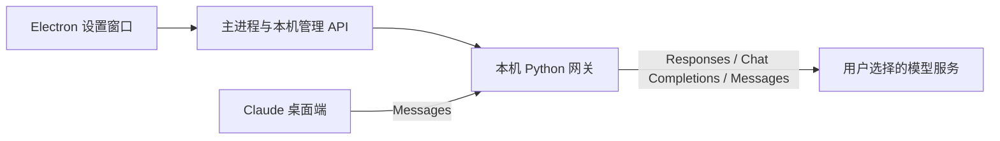

<p align="center"></p>

# ModelBridge

**把自己的模型服务接入 Claude 桌面端。** 一个面向 macOS 的开源模型连接工具。

[](https://github.com/leenlbma/modelbridge/actions/workflows/ci.yml) [](LICENSE)

中文 · [English](README_EN.md) · [下载预览版](https://github.com/leenlbma/modelbridge/releases) · [问题反馈](https://github.com/leenlbma/modelbridge/issues)

**v0.3.2 · 开源预览版 · Apple Silicon / macOS 14+。** ModelBridge 是第三方工具，与 Anthropic 或所列服务商无隶属关系。当前目标入口是 Claude 桌面端的 Code 功能；供应商预设不等于真实兼容性已通过。

## 能做什么

- 选择 OpenAI、Anthropic、DeepSeek、OpenRouter 或自定义服务，用自己的 API Key 连接模型。
- 适配 Responses、Chat Completions 和 Anthropic Messages 三种接口；一次启用一个服务和模型。
- 保存前检查文字回复、流式工具参数与工具结果回传，验证失败保留原连接。
- 原生窗口、菜单栏、快捷键、系统保存面板；应用内检查、安装、恢复和停用后台服务。
- 优先复用兼容服务、Python 和依赖缓存，仅缺少时下载；退出客户端后后台继续运行。
- 导出不含 Key 的 Claude 配置和脱敏诊断。网关仅监听本机，上游 Key 不以明文写入网关配置。

## 开始使用

1. 从 [Releases](https://github.com/leenlbma/modelbridge/releases) 下载最新预览版 DMG，将 **ModelBridge.app** 拖入“应用程序”。需要 Apple Silicon、macOS 14+、[Claude 桌面端](https://claude.com/download) 和自己的服务商 API Key。应用仅有 ad-hoc 签名，尚无 Apple 公证；系统阻止时，确认下载来源后在“系统设置 → 隐私与安全性”允许本次打开。
2. 打开 ModelBridge，按提示检查环境。已有兼容服务直接使用，停用的服务优先恢复；首次缺少环境时需要联网下载，无需自己安装 Python 或 Node。
3. 选择服务，填写 Key 和模型 ID。可获取模型列表，也可手填。自定义地址使用 API Base URL，例如 `https://api.example.com/v1`，不追加 `/responses`、`/chat/completions` 或 `/messages`。
4. 点击“验证并保存”或按 **⌘ Enter**。验证会消耗少量服务商额度，最多等待 180 秒，可取消；当前有未完成推理时不会切换连接。
5. 在“接入 Claude”导出配置。在 Claude 中启用 **Help → Troubleshooting → Enable Developer Mode**，再打开 **Developer → Configure Third-Party Inference… → Import configuration**，补充同一个服务商 Key，执行 **Test connection → Apply Changes → Save & Restart**。这些入口可能随 Claude 版本变化。
6. 在 Code 中选择项目并开始任务。控制台显示成功请求后，才说明 Claude 实际连上网关。

换服务或模型后，重新验证并更新 Claude 配置、新建对话。当前尚无多连接收藏、系统钥匙串或自动更新。菜单栏可重新打开客户端；“状态与帮助 → 停用后台服务”会停止登录启动并保留数据。

## 服务与验证边界

| 服务 | 默认接口 | 当前证据 |
| --- | --- | --- |
| OpenAI | Responses | 模拟 HTTP 与真实转换器回归；官方账号和实际 Code 任务待测 |
| Anthropic | Messages | 原生转发模拟回归；官方账号和实际 Code 任务待测 |
| DeepSeek | Chat Completions | 模拟回归；真实账号和实际 Code 任务待测 |
| OpenRouter | Chat Completions | 模拟回归；真实账号和实际 Code 任务待测 |
| 自定义服务 | 三种接口任选 | 每个地址、模型和客户端版本需要单独验证 |

不支持 Azure 专用认证、云平台签名认证、无 Key 上游、多服务路由或自动故障切换。**Claude Design、Cowork、图片、附件、长上下文与 Claude Code CLI 未完成独立验收**；第三方 Key 不会解锁官方账号权益。Token 数量为估算值，默认关闭 Claude 价格和 1M 上下文声明。

完整边界见 [兼容性矩阵](docs/COMPATIBILITY.md) 与 [验证记录](docs/VALIDATION.md)。

## 工作方式与数据



LiteLLM 负责消息格式转换；HTTP 请求由 ModelBridge 发往已保存的地址。Renderer 开启沙盒与上下文隔离，管理凭据留在主进程；网关检查 Host、Origin 和认证。验证 Key 仅临时使用，配置保存 SHA-256 指纹；推理使用 Claude 携带的 Key。Claude 如何保存凭据由其自身决定。

新安装数据位于 `~/Library/Application Support/ModelBridge/`，后台项显示为 **ModelBridge 模型连接服务**。已有旧安装沿用数据目录与服务标识；完整 schema-2 配置保留自定义地址。没有地址的 schema-1 配置需要重新填写并验证，成功前不覆盖原文件。详见 [桌面说明](docs/DESKTOP.md) 和 [安全政策](SECURITY.md)。

## 开发与构建

Python 3.12、Node 22.12+；运行依赖完整版本固定在 `requirements.lock`。

```sh
git clone https://github.com/leenlbma/modelbridge.git
cd modelbridge
python3.12 -m venv .venv
.venv/bin/python -m pip install -r requirements.lock
npm ci
.venv/bin/python -m unittest discover -s tests -v
npm test
python3 scripts/check_public.py
python3 scripts/build_release.py
```

macOS Apple Silicon 上执行 `python3 scripts/build_desktop.py --dmg` 构建应用、ZIP 和 DMG，首次构建需下载校验过的 Electron 与 uv。`npm start` 使用已有后台打开客户端。隔离开发、测试范围和发布步骤见 [贡献指南](CONTRIBUTING.md)、[桌面说明](docs/DESKTOP.md) 和 [发布清单](docs/RELEASING.md)。

## 接下来

优先补齐真实供应商的端到端 Code 任务、全新 Mac 安装及登录恢复验收，再推进签名公证、多连接与系统钥匙串。跨平台客户端和其他 Claude 功能不在当前承诺范围内。欢迎提交脱敏兼容性记录，模板会区分模拟测试、真实网关与实际客户端任务。

## 许可证

[MIT](LICENSE)。依赖及分发声明见 [第三方声明](THIRD_PARTY_NOTICES.md)。
